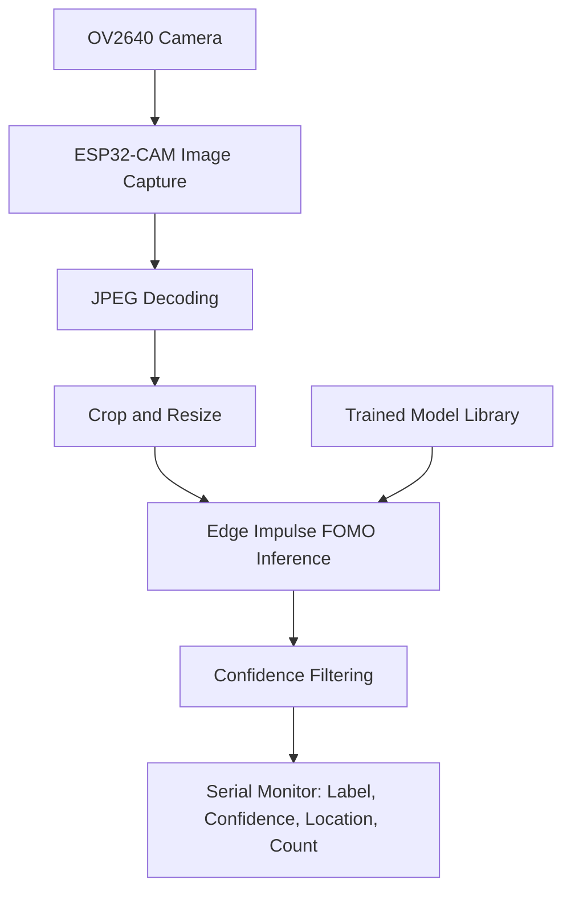

# Edge AI-Based Object Detection Using ESP32-CAM


## Project Overview

This project implements an embedded computer vision pipeline for object detection using the AI-Thinker ESP32-CAM and Edge AI. It integrates image acquisition, image preprocessing and a lightweight Edge Impulse FOMO (Faster Objects, More Objects) model to identify trained object classes directly on the microcontroller.

The camera captures images from its surroundings, converts them into the model's input format and performs local inference. The results are displayed through the serial monitor as object labels, confidence scores, approximate object locations and detection counts. After the trained model is installed, inference runs locally without a cloud service or continuous internet connection.

The project demonstrates the integration of embedded systems, computer vision and TinyML for resource-constrained devices.

## Key Features

- Live image capture using the OV2640 camera.
- On-device object detection using Edge Impulse FOMO.
- Image decoding, center cropping and bilinear resizing.
- Detection of custom trained object classes with confidence filtering.
- Approximate object localization and per-frame object counting.
- Inference timing and available memory reporting.
- PSRAM-backed image buffers and camera error handling.
- Camera-only diagnostic mode for troubleshooting.

## System Architecture



## Hardware Requirements

| Component | Purpose |
| --- | --- |
| AI-Thinker ESP32-CAM with PSRAM | Embedded processing and AI inference |
| OV2640 camera | Image acquisition |
| ESP32-CAM-MB or USB-to-UART programmer | Firmware uploading and serial communication |
| Stable regulated 5 V supply | Board power |
| USB cable and jumper wires | Connections, if needed |

## Software and Technologies

| Technology | Purpose |
| --- | --- |
| Arduino IDE | Firmware development and deployment |
| Arduino-ESP32 board package | ESP32 support and camera driver |
| C/C++ | Embedded programming |
| Edge Impulse | Object detection model training and export |
| FOMO | Lightweight object detection and approximate localization |
| INT8 quantization | Recommended model optimization for embedded deployment |

## Working Principle

1. The ESP32-CAM captures a 320 × 240 JPEG image using its OV2640 camera.
2. The firmware decodes the image into a three-channel buffer stored in PSRAM.
3. The image is center-cropped and resized to the input dimensions specified by the installed model library.
4. The processed pixels are passed to the Edge Impulse inference engine.
5. The detector identifies trained objects and filters detections below the configured confidence threshold (0.60 by default).
6. Object labels, confidence values, approximate locations, detection counts, inference timing and memory usage are printed to the serial monitor.

## Repository Structure

```text
esp32-cam-edge-ai-object-detection/
├── README.md
└── esp32_cam_object_detection/
    └── esp32_cam_object_detection.ino
```

The Arduino sketch contains the camera GPIO configuration, image preprocessing functions, inference logic and serial reporting in a single source file.

## Setup and Deployment

### 1. Install the ESP32 board package

Install Arduino IDE. Add the following URL under Preferences → Additional Boards Manager URLs:

```text
https://raw.githubusercontent.com/espressif/arduino-esp32/gh-pages/package_esp32_index.json
```

Open Boards Manager and install **esp32 by Espressif Systems**, using a version compatible with the generated model library.

### 2. Install the trained model library

The firmware uses an Edge Impulse FOMO object detection model. To reproduce the project, use the trained project library or train a compatible model with your own labelled images and export it as an Arduino library (INT8 recommended). A 96 × 96 input is a practical starting point for the classic ESP32-CAM; actual dimensions are read from the installed model.

In Arduino IDE, select Sketch → Include Library → Add .ZIP Library and select the exported library. If its generated header has a different name, update the following line in the sketch:

```cpp
#include <esp32_cam_fomo_inferencing.h>
```

The generated library contains the model weights and inference SDK. It is an external dependency and is not included in this source-code repository. The detector recognizes the classes in that library, not arbitrary objects.

### 3. Configure the board

Open `esp32_cam_object_detection/esp32_cam_object_detection.ino` and select the following board settings where available:

| Setting | Value |
| --- | --- |
| Board | AI Thinker ESP32-CAM |
| Upload speed | 115200 |
| Partition scheme | Huge APP or another sufficiently large app partition |
| PSRAM | Enabled |
| Serial monitor | 115200 baud |

### 4. Upload the program

Use an ESP32-CAM-MB programmer, or wire a USB-to-UART adapter as follows with the board powered off:

| Connection | ESP32-CAM pin |
| --- | --- |
| USB-UART TX (3.3 V logic) | U0R / GPIO3 |
| USB-UART RX | U0T / GPIO1 |
| Common ground | GND |
| Stable regulated 5 V supply | 5V |
| Temporary boot jumper | GPIO0 to GND |

Use 3.3 V UART logic, a single appropriate power source, and common ground. Reset with GPIO0 grounded to enter programming mode. Upload the sketch, remove the GPIO0 jumper and reset the board to start the program. Follow the programmer's instructions if using an ESP32-CAM-MB.

### 5. Run the application

Open the Serial Monitor at 115200 baud and place a trained object in the camera's field of view. The firmware prints a `DETECTION` line for each accepted detection, `NO_DETECTION` when no object passes the threshold, and a `FRAME` summary.

To test camera functionality before installing the model, set `EDGE_AI_ENABLED` to `0`. The firmware reports `CAMERA_OK` without running inference. Verify that the camera's color channel order and framing match the model's training preprocessing; adjust `JPEG_OUTPUT_IS_BGR` if necessary.

## Output

The firmware reports the following fields:

| Field | Description |
| --- | --- |
| `label` | Detected object class |
| `confidence` | Model confidence, on a scale from 0 to 1 |
| `center` | Approximate object center in model-input pixels |
| `region` | FOMO grid region in model-input pixels |
| `count` | Number of accepted detections in the frame |
| `dsp_ms` / `inference_ms` | Preprocessing within the SDK and model inference time |
| `pipeline_ms` | Capture-to-inference elapsed time |
| `free_heap` / `free_psram` | Available memory in bytes |

FOMO estimates object locations using a grid, not precise object outlines. Close objects may merge. Model accuracy and speed depend on the trained model, scene and device configuration; no benchmark numbers are claimed here.

## Applications

- Embedded computer vision demonstrations
- Small-scale object counting and inventory prototypes
- Robotics and automation prototypes
- Controlled visual inspection
- TinyML and Edge AI learning projects

## Future Enhancements

- Local web dashboard for viewing detection results.
- IoT integration for reporting detected events.
- Additional custom object classes and model optimization.
- Camera preview with visual detection overlays.

## Conclusion

This project illustrates how image capture, preprocessing and lightweight machine learning can be integrated into a single ESP32-CAM application. Local inference reduces dependence on remote computing services and provides a foundation for low-cost embedded vision systems.

## References

- [Espressif ESP32 Camera Driver](https://github.com/espressif/esp32-camera)
- [Arduino ESP32](https://github.com/espressif/arduino-esp32)
- [Edge Impulse Studio](https://studio.edgeimpulse.com/)
- [Edge Impulse FOMO](https://www.edgeimpulse.com/blog/announcing-fomo-faster-objects-more-objects/)
